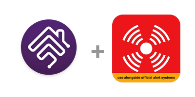
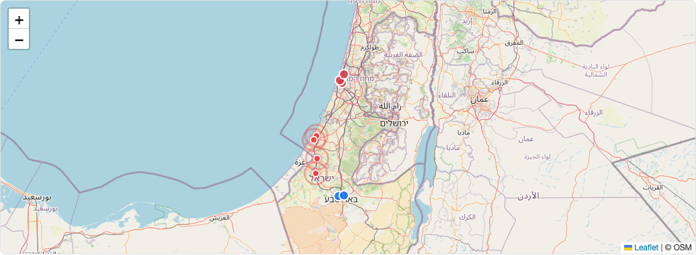
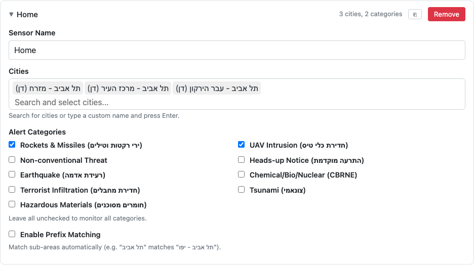
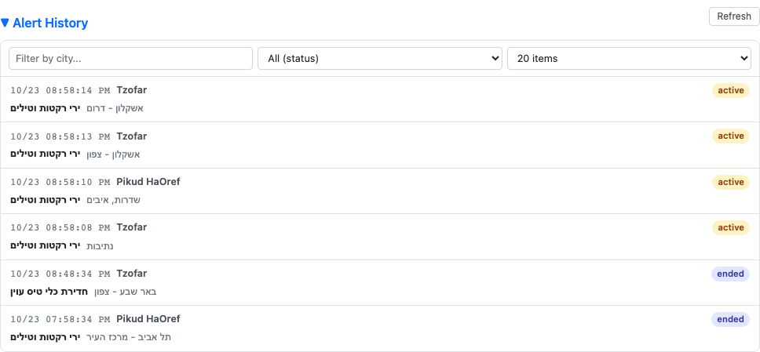

<div align="center">

<a href="https://github.com/toharush/homebridge-redalert"></a>

# Homebridge Red Alert

### Israel Pikud HaOref (Home Front Command) Red Alert – Tzeva Adom – for Apple HomeKit

**Rocket, missile, UAV, terror and earthquake alerts for your city, as HomeKit sensors you can automate.**

<p dir="rtl"><strong>תוסף Homebridge להתרעות צבע אדום של פיקוד העורף ב-HomeKit – ירי רקטות וטילים, חדירת כלי טיס עוין, חדירת מחבלים ורעידות אדמה.</strong></p>

[](https://github.com/homebridge/homebridge/wiki/Verified-Plugins)
[](https://www.npmjs.com/package/@toharush/homebridge-redalert)
[](https://www.npmjs.com/package/@toharush/homebridge-redalert)
[](https://github.com/toharush/homebridge-redalert/stargazers)


**[Quick Start](#quick-start)** · **[Features](#why-homebridge-red-alert)** · **[Screenshots](#screenshots)** · **[Automations](#automation-ideas)** · **[Configuration](#configuration)** · **[FAQ](#faq)** · **[עברית](#בעברית)**

</div>

---

> **The siren sounds. Your lights turn red, the hallway to the shelter (ממ"ד) lights up and your HomePod sounds the alarm – before you even reach your phone.**

Homebridge Red Alert turns every Pikud HaOref (פיקוד העורף) alert into a HomeKit **motion sensor** that switches ON for the cities you choose and OFF when the Home Front Command announces the event has ended. Build any automation you want on top of it.

<p align="center">
  
  <br><sub>The built-in coverage map: your monitored cities per sensor, with live alerts pulsing in red.</sub>
</p>

<div align="center">

| ⚡ **~50 ms** | 🛰️ **2 sources at once** | 🏙️ **1,450 cities** | 🚨 **9 alert types** | 🧪 **340+ tests** |
|:---:|:---:|:---:|:---:|:---:|
| Tzofar WebSocket push | Pikud HaOref + Tzofar | every Home Front Command zone | rockets to tsunami | incl. life-safety suite |

</div>

## Why Homebridge Red Alert

### 🚀 Fast and redundant
- **Two sources at the same time** – Pikud HaOref (HTTP, polled every second) and Tzofar / tzevaadom.co.il (WebSocket push, ~50 ms). Whichever reports first triggers your sensor.
- **No duplicates** – a 30-second sliding window merges the same alert from different sources, so your automation fires once.
- **Self-healing connections** – after a failure the Pikud HaOref timeout tightens to retry faster, and the WebSocket reconnects with backoff and drops connections that went silently dead.
- **Backup sources in one click** – add Mako, Prog.co.il or Kumta Telegram channels from the built-in marketplace (beta).

### 🛡️ Built for when it matters
- **Drills never set off your house** – Tzofar drill messages are ignored.
- **Never stuck ON** – sensors clear on "Event Ended", and a separate timer auto-clears them after a timeout even if every source is offline.
- **Life-safety tested** – a dedicated test suite checks that a new alert always beats an "ended" message, that another city's all-clear can't switch off yours, and that webhooks fire once.
- **Robust parsing** – "Event Ended" is recognized even when Pikud HaOref sends it under the wrong category, and Tzofar early warnings and all-clears are detected from structured data or Hebrew text.
- **Health check switch** – an optional HomeKit switch turns OFF when no alert source is reachable, so you know your alerts are working.

### 🏠 Made for HomeKit
- **As many locations as you want** – home, office, parents, kids' school. Each is its own HomeKit sensor with its own cities and alert types.
- **Every alert type** – rockets & missiles, hostile UAVs, terrorist infiltration, early warnings, earthquakes, tsunami, hazardous materials, non-conventional threats.
- **Nationwide alerts handled** – `רחבי הארץ` triggers every configured city, still respecting your alert-type filter.
- **Automations survive restarts** – accessories keep the same identity, and removed sensors are cleaned up automatically.
- **Webhooks** – POST/PUT to Home Assistant, Node-RED, n8n or your own server on every alert and every all-clear.

### ⚙️ A config UI you'll actually enjoy
- Searchable picker for all **1,450** Hebrew city zones, with their area shown
- Interactive coverage map with live alerts, collapsible alert history with filters, live source status
- Dark mode, inline validation, one-click sensor duplication, automatic migration from v1

### 🔒 Private by design
- No account, no sign-up, no telemetry. The plugin talks only to the alert sources and the webhooks you configure. (The config page's map loads its tiles from OpenStreetMap.)
- Homebridge Verified, free and open source (MIT).

## Screenshots

<table>
  <tr>
    <td width="50%"><br><sub><b>Per-sensor settings</b> – pick cities in Hebrew and choose which alert types trigger it.</sub></td>
    <td width="50%"><br><sub><b>Alert history</b> – every alert with its source, city and status, filterable.</sub></td>
  </tr>
</table>

<sub>Screenshots show demo data.</sub>

## Quick Start

1. In the Homebridge UI, open **Plugins** and search for **`red alert`** or **`pikud haoref`**. Install **Red Alert (Pikud HaOref)** by toharush. Or from the terminal:

   ```bash
   npm install -g @toharush/homebridge-redalert
   ```

2. Open the plugin settings, add a sensor, and pick your cities from the Hebrew city list (e.g. `תל אביב - מרכז העיר`).
3. Restart Homebridge. A motion sensor appears in the Home app. Build automations on it.

## Automation Ideas

| When the sensor… | Do this in the Home app |
|------------------|-------------------------|
| 🔴 Detects motion (alert started) | Turn every light red at 100% |
| 🚪 Detects motion | Turn on the hallway and shelter (ממ"ד) lights, open smart blinds |
| 🔊 Detects motion | Play a sound or a playlist on your HomePod / AirPlay speakers |
| 📱 Detects motion on "Parents" sensor | Get a Home app notification (enable notifications on that sensor) |
| ✅ Stops detecting motion (event ended) | Restore the previous scene |
| ⚠️ Health-check switch turns OFF | Get notified that alerts are not being received |

Need more than HomeKit? Use [webhooks](#webhooks) to forward every alert to Home Assistant, Node-RED or any HTTP endpoint.

## How It Works

1. The plugin creates one **motion sensor** per configured sensor in HomeKit.
2. An **alert pipeline** ingests alerts from multiple sources simultaneously — **Pikud HaOref** (HTTP polling every 1s) and **Tzofar** (WebSocket push, ~50ms delivery) are built-in. Add-on sources (Telegram channels, Mako, Prog.co.il, or custom HTTP/WebSocket) can be added via the UI.
3. On each poll, alerts first pass through an **ExpiryStage** — it reads the dedup's active city timestamps and injects synthetic "Event Ended" alerts for cities that haven't been refreshed within the configured timeout (default: 30 min). This scan runs every ~30 seconds with zero per-poll cost.
4. Alerts (including any synthetic event-ended) then pass through a **DeduplicationStage** — a per-category city-level check (30s sliding window) ensures cross-source duplicates only fire once. The stage simultaneously builds a `ParsedAlerts` structure for downstream consumers (zero extra parsing).
5. Each sensor independently filters deduplicated alerts by its configured cities, categories, and optional prefix matching.
6. When an alert matches, the sensor turns **ON** and webhooks fire. Nationwide alerts (`רחבי הארץ`) activate all configured cities.
7. The sensor stays **ON** until an "Event Ended" message is received from any source, or ExpiryStage auto-clears it after the timeout.
8. A **health check** accessory (optional HomeKit switch) monitors source connectivity and turns OFF when all sources are unreachable.
9. Create HomeKit automations based on each motion sensor (e.g. flash lights, play a sound, send a notification).

---

## Configuration

Configure via the Homebridge UI with the built-in **searchable city selector**, or manually in `config.json`:

```json
{
  "platform": "RedAlert",
  "sensors": [
    {
      "name": "Home",
      "cities": ["תל אביב - מרכז העיר", "חיפה - מערב"],
      "categories": ["rockets", "uav", "earthquake", "terror"],
      "prefix_matching": false
    }
  ],
  "turnoff_delay": 0,
  "alert_timeout": 1800000,
  "polling_interval": 1000,
  "request_timeout": 3000,
  "reconnect_interval": 10000,
  "max_reconnect_interval": 60000,
  "ping_interval": 60000,
  "pong_timeout": 420000,
  "health_check": false,
  "health_check_threshold": 5,
  "debug": false
}
```

> **Migration note:** Upgrading from v1.x? Your comma-separated `cities` strings will be automatically migrated to the new array format on first launch. No action needed.

### Multi-Sensor Example

Each sensor creates a separate motion sensor in HomeKit with its own cities, categories, and prefix matching:

```json
{
  "platform": "RedAlert",
  "sensors": [
    { "name": "Home", "cities": ["תל אביב - מרכז העיר"], "categories": ["rockets", "uav"] },
    { "name": "Office", "cities": ["חיפה"], "prefix_matching": true },
    { "name": "Parents", "cities": ["באר שבע - צפון"], "categories": ["rockets"] }
  ]
}
```

---

## Alert Sources

### Built-in Sources

The plugin ships with two built-in alert sources that run simultaneously:

| Source | Type | Description |
|--------|------|-------------|
| **Pikud HaOref** | HTTP polling | Official Home Front Command API, polled every second (configurable) with adaptive timeout |
| **Tzofar** | WebSocket | Real-time push alerts from tzevaadom.co.il with automatic reconnection, keep-alive, early warning, and event-ended support (city IDs resolved from Tzofar's city database) |

Both sources feed into the same deduplication pipeline, so you get the fastest possible alert delivery without duplicates.

### Source Marketplace (Beta)

The config UI includes a one-click marketplace for add-on sources. All marketplace sources are in **beta** and are not recommended as your sole alert source:

| Source | Type | Description |
|--------|------|-------------|
| **Mako** | HTTP | Mako/N12 news mirror of Pikud HaOref. No geo-restriction. |
| **Prog.co.il** | HTTP | Independent alert mirror with per-city items and TTL. |
| **Kumta Rockets** | Telegram | Kumta channel for rocket & missile alerts. Requires Telegram API credentials. |
| **Kumta Terror** | Telegram | Kumta channel for terrorist infiltration alerts. Requires Telegram API credentials. |

### Telegram Sources (Beta)

Telegram sources monitor alert channels and parse city names from message content. Setup:

1. Get API credentials from [my.telegram.org](https://my.telegram.org)
2. Add a Telegram source from the **Source Marketplace** (e.g. Kumta Rockets, Kumta Terror)
3. Enter your API ID and API Hash when prompted
4. Scan the QR code in Telegram (Settings > Devices > Link Desktop Device)
5. Once connected, the session is saved — no re-authentication needed on restart

Each Telegram source has a default alert category (e.g. rockets, terror) used when no keyword is detected in the message header. City names are extracted from the message body and matched against the plugin's city database.

### Custom Add-on Sources

You can add custom HTTP, WebSocket, or Telegram sources via the UI or `config.json`. Custom sources support category mapping to translate source-specific alert types to the plugin's categories — including `eventended` to signal that an alert has cleared:

```json
{
  "platform": "RedAlert",
  "sensors": [{ "name": "Home", "cities": ["תל אביב - מרכז העיר"] }],
  "custom_sources": [
    {
      "name": "My Alert API",
      "type": "http",
      "url": "https://my-alert-api.example.com/alerts",
      "headers": { "Authorization": "Bearer ..." },
      "category_field": "type",
      "category_mapping": {
        "ROCKET": "rockets",
        "DRONE": "uav",
        "CLEAR": "eventended"
      }
    },
    {
      "name": "My WS Feed",
      "type": "websocket",
      "url": "wss://my-ws-feed.example.com/alerts",
      "message_type": "ALERT",
      "message_data_field": "data",
      "category_field": "threat",
      "category_mapping": {
        "0": "rockets",
        "5": "uav",
        "2": "terror",
        "99": "eventended"
      }
    }
  ]
}
```

`category_field` tells the plugin which JSON field holds the category ID in each alert object (defaults to `"cat"`). Then `category_mapping` maps each ID value from your source to a plugin alert type. Map a value to `eventended` to signal that an alert has cleared for the listed cities — this immediately deactivates matching sensors. If no `eventended` mapping is provided, the plugin's ExpiryStage will auto-clear alerts after the configured timeout.

For reference: Pikud HaOref uses field `cat` with values `1`=rockets, `6`=uav; Tzofar uses field `threat` with values `0`=rockets, `5`=uav.

### Webhooks

Send an HTTP request when any sensor activates or deactivates. The payload includes the sensor name, city, alert title, event type, and timestamp — route or filter on the receiving end:

```json
{
  "platform": "RedAlert",
  "sensors": [{ "name": "Home", "cities": ["תל אביב - מרכז העיר"] }],
  "webhooks": [
    {
      "url": "https://my-server.example.com/alert-hook",
      "method": "POST",
      "headers": { "Authorization": "Bearer my-token" }
    }
  ]
}
```

**Payload format:**

```json
{
  "event": "alert",
  "sensor": "Home",
  "city": "תל אביב - מרכז העיר",
  "title": "ירי רקטות וטילים",
  "timestamp": 1700000000000
}
```

The `event` field is `"alert"` when a sensor activates and `"ended"` when it deactivates. Multiple webhook URLs can be configured — all fire for every sensor event.

---

## Options Reference

### Sensor Options

| Option | Required | Default | Description |
|--------|----------|---------|-------------|
| `name` | Yes | — | Unique sensor name (appears in HomeKit) |
| `cities` | Yes | — | Array of city names in Hebrew. Select from the built-in list or type custom names |
| `categories` | No | All | Alert types to monitor. If empty, all categories are enabled |
| `prefix_matching` | No | `false` | City names match by prefix (e.g. "תל אביב" matches all Tel Aviv sub-areas) |

### HTTP Source Options

| Option | Default | Description |
|--------|---------|-------------|
| `polling_interval` | `1000` | How often to poll HTTP sources in ms (500–5,000) |
| `request_timeout` | `3000` | Max time to wait for HTTP response in ms (1,000–10,000) |

### WebSocket Source Options

| Option | Default | Description |
|--------|---------|-------------|
| `reconnect_interval` | `10000` | Initial delay (ms) before reconnecting after disconnect |
| `max_reconnect_interval` | `60000` | Maximum reconnect delay (ms) after repeated failures (exponential backoff cap) |
| `ping_interval` | `60000` | How often (ms) to send a keep-alive ping |
| `pong_timeout` | `420000` | Max time (ms) to wait for a pong response before terminating (default: 7 min) |

### Sensor Behavior

| Option | Default | Description |
|--------|---------|-------------|
| `turnoff_delay` | `0` | Delay (ms) before turning off after alert ends. Resets if a new alert arrives (0–3,600,000) |
| `alert_timeout` | `1800000` | Auto-clear alerts (ms) if "Event Ended" is never received. Default: 30 min (600,000–3,600,000) |

### Health Monitoring

| Option | Default | Description |
|--------|---------|-------------|
| `health_check` | `false` | Adds a Switch to HomeKit that turns OFF when all sources are unreachable |
| `health_check_threshold` | `5` | Consecutive failures per source before reporting unhealthy (2–30) |

### Webhooks

| Option | Required | Default | Description |
|--------|----------|---------|-------------|
| `url` | Yes | — | The endpoint URL to call on alert/ended events |
| `method` | No | `POST` | HTTP method (`POST` or `PUT`) |
| `headers` | No | `{}` | Custom headers (e.g. `{"Authorization": "Bearer ..."}`) |

### Telegram Options

| Option | Required | Default | Description |
|--------|----------|---------|-------------|
| `telegram_api_id` | Yes* | — | Telegram API ID from [my.telegram.org](https://my.telegram.org). Required when using Telegram sources |
| `telegram_api_hash` | Yes* | — | Telegram API Hash from [my.telegram.org](https://my.telegram.org). Required when using Telegram sources |

### General

| Option | Default | Description |
|--------|---------|-------------|
| `debug` | `false` | Enable extra debug logging |

### Available Categories

These categories can be selected per-sensor to filter which alert types trigger the sensor:

| Key | Description |
|-----|-------------|
| `rockets` | Rockets & Missiles (ירי רקטות וטילים) |
| `uav` | UAV Intrusion (חדירת כלי טיס) |
| `nonconventional` | Non-conventional Threat |
| `warning` | Heads-up Notice (התרעה מוקדמת) |
| `earthquake` | Earthquake (רעידת אדמה) |
| `cbrne` | Chemical / Bio / Nuclear |
| `terror` | Terrorist Infiltration (חדירת מחבלים) |
| `tsunami` | Tsunami (צונאמי) |
| `hazmat` | Hazardous Materials (חומרים מסוכנים) |

> **Note:** `eventended` is a special mapping key available only in custom source `category_mapping`. It signals that alerts have cleared for the listed cities. It is not selectable per-sensor — event-ended is always processed automatically to deactivate sensors.

---

## FAQ

**Is this an official Pikud HaOref / Home Front Command app?**
No. It is a community plugin that reads the public Pikud HaOref alert feed plus other public alert sources. Always keep the official Home Front Command app and sirens as your primary warning.

**Is this the same package as `homebridge-redalert` (without `@toharush/`)?**
No. That unscoped npm package is an unrelated plugin from 2021. This plugin is published as **`@toharush/homebridge-redalert`** and is the Homebridge Verified one.

**How fast are the alerts?**
Tzofar pushes alerts over a WebSocket (~50 ms delivery) and Pikud HaOref is polled every second. The first source to report an alert triggers the sensor; the others are deduplicated.

**Which alert types are supported?**
Rockets & missiles (ירי רקטות וטילים), hostile aircraft / UAV intrusion (חדירת כלי טיס עוין), terrorist infiltration (חדירת מחבלים), early warnings (התרעה מוקדמת), earthquake (רעידת אדמה), tsunami, hazardous materials, and non-conventional / CBRNE threats. See [Available Categories](#available-categories).

**Can I monitor more than one city?**
Yes. Every sensor can hold any number of cities, and you can create as many sensors as you like. Prefix matching covers sub-areas (e.g. `תל אביב` matches `תל אביב - מרכז העיר` and `תל אביב - מזרח`). Nationwide alerts (`רחבי הארץ`) trigger every sensor.

**Does it work if Homebridge runs outside Israel?**
The Pikud HaOref API may block requests from outside Israel. Tzofar keeps working, and you can add the Mako source from the marketplace, which has no geo-restriction.

**Does it cost anything?**
No. It is free and open source under the MIT license.

**Does adding more sensors add more network traffic?**
No. All sensors share one alert pipeline, so 1 sensor or 20 sensors use the same connections.

---

## Under the Hood

<details>
<summary><strong>Architecture</strong></summary>

```
┌────────────────┐  ┌────────────────┐  ┌────────────────┐
│  Pikud HaOref  │  │     Tzofar     │  │  Add-on Source │
│  (HTTP poll)   │  │  (WebSocket)   │  │ (HTTP/WS/TG)  │
└───────┬────────┘  └───────┬────────┘  └───────┬────────┘
        │                   │                    │
        └───────────────────┼────────────────────┘
                            ▼
              ┌──────────────────────────────┐
              │        AlertPipeline         │
              │                              │
              │  ┌────────────────────────┐  │
              │  │      ExpiryStage       │  │
              │  │  (auto-clear 30 min)   │  │
              │  │  reads dedup's seen    │  │
              │  └───────────┬────────────┘  │
              │              │               │
              │  ┌───────────┴────────────┐  │
              │  │   DeduplicationStage   │  │──▶ AlertHistory
              │  │  (30s sliding window)  │  │
              │  │  + builds ParsedAlerts │  │
              │  └───────────┬────────────┘  │
              │              │               │
              │  ┌───────────┴────────────┐  │
              │  │    Fan-out to all      │  │
              │  │    listeners           │  │
              │  └───────────┬────────────┘  │
              └──────────────┼───────────────┘
                             │
          ┌──────────────────┼──────────────────┐
          ▼                  ▼                  ▼
    ┌───────────┐     ┌───────────┐     ┌───────────┐
    │ Sensor A  │     │ Sensor B  │     │ Sensor C  │
    │  filter   │     │  filter   │     │  filter   │
    └─────┬─────┘     └─────┬─────┘     └─────┬─────┘
          │                  │                  │
     ┌────┴────┐       ┌────┴────┐       ┌────┴────┐
     ▼         ▼       ▼         ▼       ▼         ▼
 ┌───────┐ ┌──────┐ ┌───────┐ ┌──────┐ ┌───────┐ ┌──────┐
 │HomeKit│ │Web-  │ │HomeKit│ │Web-  │ │HomeKit│ │Web-  │
 │Motion │ │hook  │ │Motion │ │hook  │ │Motion │ │hook  │
 │Sensor │ │(POST)│ │Sensor │ │(POST)│ │Sensor │ │(POST)│
 └───────┘ └──────┘ └───────┘ └──────┘ └───────┘ └──────┘
```

Adding sensors does **not** add API calls — all sensors share the same pipeline. ExpiryStage runs first (reads dedup's `seen` Map to detect stale cities), then DeduplicationStage ensures each city/category combination only triggers once per 30-second window, regardless of how many sources report it. Both stages share the same Map for zero per-poll overhead.

</details>

<details>
<summary><strong>What's new in v2</strong></summary>

- **Multi-source alert pipeline** — Alerts stream from Pikud HaOref (HTTP) and Tzofar (WebSocket) simultaneously. Custom HTTP/WebSocket sources can be added via the UI.
- **Tzofar early warning & event-ended** — Full SYSTEM_MESSAGE support: early warnings (`instructionType=0`) and event-ended (`instructionType=1`) are parsed with city ID resolution from Tzofar's city database (fetched on startup).
- **Sliding-window deduplication** — Identical alerts from different sources are merged using a 30-second sliding window so sensors only fire once, with no boundary edge cases.
- **Automatic expiry** — Cities auto-clear after the configured timeout (default 30 min) if no "Event Ended" is received. Zero per-poll overhead — scans only when needed.
- **Coverage map** — Interactive Leaflet map in the config UI shows all monitored cities with per-sensor color-coded markers.
- **Active alert overlay** — Pulsing red markers on the map show currently active alerts in real-time. Click an active alert in history to fly to its location.
- **Live connection status** — Green/red status dots on each built-in source card show real-time connectivity.
- **Alert history** — Collapsible panel with filters (city, active/ended) and configurable item limit. Auto-refreshes every 2 seconds.
- **Collapsible UI** — Sensors and source cards collapse/expand for a cleaner config experience.
- **Duplicate sensor** — One-click clone of any sensor to quickly set up multiple locations with similar settings.
- **Inline validation** — Real-time validation highlights missing sensor names or empty city lists before you save.
- **Onboarding empty state** — Friendly first-run experience guides new users through adding their first sensor.
- **Category mapping UI** — Custom sources now clearly show how to map source-specific IDs to plugin alert types, with a dedicated "Category ID Field" input.
- **Prefix matching** — Match sub-areas automatically (e.g. "תל אביב" matches "תל אביב - מרכז העיר").
- **Webhooks** — Fire HTTP POST/PUT to any URL when a sensor activates or deactivates. Payload includes sensor name, city, title, and timestamp. Configure multiple endpoints with a 10-second timeout per request.
- **Health check accessory** — Optional HomeKit switch that turns OFF when all sources are unreachable.
- **Source marketplace (Beta)** — One-click add pre-configured add-on sources from the config UI: Mako (HTTP), Prog.co.il (HTTP), and Telegram channels (Kumta Rockets, Kumta Terror). All add-on sources are in beta. Telegram sources use QR-based login — no bot tokens needed.
- **Automatic config migration** — v1.x comma-separated city strings and `custom_cities` fields are auto-migrated atomically on first launch.

</details>

<details>
<summary><strong>v1 vs v2 comparison</strong></summary>

| Metric | v1 | v2 | Notes |
|--------|----|----|-------|
| Alert sources | 1 (Pikud HaOref HTTP) | 2+ (HTTP + WebSocket + add-ons) | Fastest alert wins |
| Deduplication | None | Sliding 30s window | No duplicate sensor triggers |
| Expiry | Per-sensor timer | Centralized ExpiryStage | Zero per-poll overhead |
| Network connections | 1 HTTP poll | 1 HTTP poll + 1 WebSocket | +1 persistent connection |
| Memory overhead | ~2 MB | ~4 MB | +dedup map, history buffer, WebSocket buffers |
| Dependencies | lodash | lodash + ws | +1 production dep (~200 KB) |
| Disk I/O | None | Status + history (on change only) | Async non-blocking writes |
| Recovery time | Up to polling interval | WebSocket: instant reconnect with backoff; HTTP: next poll cycle | Dual-source redundancy |
| Performance | Baseline | 0.64–0.90x (faster) | Pipeline overhead is negative at ≤50 alerts |
| Test coverage | ~60 tests | 340+ tests | ~5x increase |

**Bottom line:** v2 is **10-36% faster** than v1 for realistic workloads (≤50 simultaneous alerts) while adding deduplication, automatic expiry, and full alert history. The pipeline eliminates redundant parsing by building `ParsedAlerts` as a free side effect of dedup.

</details>

---

## בעברית

<div dir="rtl">

**Homebridge Red Alert** הוא תוסף Homebridge מאומת שמחבר את התרעות **צבע אדום** של **פיקוד העורף** ל-Apple HomeKit.

לכל מיקום שתגדירו (בית, עבודה, הורים) נוצר חיישן תנועה ב-HomeKit, שנדלק כשיש התרעה באחת הערים שבחרתם ונכבה כשמתקבלת הודעת "האירוע הסתיים". אפשר לבנות עליו אוטומציות באפליקציית הבית: להדליק את האורות באדום, להדליק את האור בממ"ד, להשמיע צליל ב-HomePod ועוד.

- התרעות מפיקוד העורף ומצופר במקביל, בלי כפילויות
- ירי רקטות וטילים, חדירת כלי טיס עוין, חדירת מחבלים, התרעה מוקדמת, רעידת אדמה ועוד
- בחירת ערים בעברית, מפת כיסוי, היסטוריית התרעות ו-webhooks
- תרגילים לא מפעילים את החיישן, והחיישן נכבה אוטומטית גם אם כל המקורות לא זמינים
- בחירה מתוך 1,450 אזורי התרעה, מפת כיסוי חיה ומצב כהה
- חינמי וקוד פתוח

**התקנה:** בממשק Homebridge חפשו `red alert` או `pikud haoref` והתקינו את **Red Alert (Pikud HaOref)**, או הריצו:

</div>

```bash
npm install -g @toharush/homebridge-redalert
```

---

## Documentation

For detailed docs, automation examples and troubleshooting, see the [Wiki](https://github.com/toharush/homebridge-redalert/wiki). Found a bug or have an idea? [Open an issue](https://github.com/toharush/homebridge-redalert/issues).

If this plugin helps keep your family safe, please ⭐ **star the repo** – it helps other people in Israel find it.

---

## Disclaimer

**חשוב מאוד לקרוא!**

התוסף איננו תוסף רשמי של פיקוד העורף או מערכת הביטחון.
התוסף משתמש ב-API של פיקוד העורף לקבלת התרעות ולכן ייתכנו שיבושים.
בכל מקרה יש להמשיך להשתמש באמצעים הרשמיים של מערכת הביטחון.

1. This plugin is **not** an official Home Front Command product.
2. The plugin uses the Pikud HaOref public API. There may be delays or disruptions.
3. **Always** use the official alert systems alongside this plugin.

---

## License

MIT
